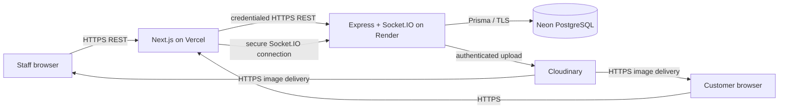
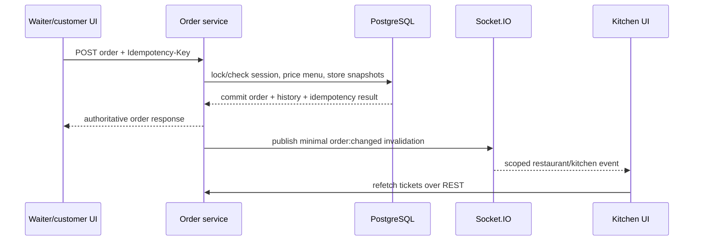

# RestroFlow architecture

## System context



The browser calls the API directly; Next.js is not an API gateway. The web origin and API origin are therefore separately allowlisted. PostgreSQL is authoritative for durable application state. Socket.IO carries scoped invalidations, never the only copy of business data.

## Monorepo boundaries

- `apps/web`: Next.js App Router UI. Server Components define route shells; client components are limited to interactive authentication, forms, queries, carts, realtime subscriptions, and charts.
- `apps/api`: Express modular monolith. One Node process owns REST and Socket.IO on the same HTTP server.
- `packages/contracts`: framework-neutral wire schemas, shared response/event types, and Zod validation.
- `apps/api/prisma`: Prisma schema, 11 immutable migrations, local connectivity/admin seed, and an explicit guarded demo seed.

## Backend module structure

```text
route -> authentication/authorization + boundary schema
      -> controller (HTTP translation)
      -> service (business rules + transaction boundary)
      -> repository (restaurant-scoped persistence)
      -> PostgreSQL
```

Feature modules cover authentication, restaurants/staff, menu, tables, orders, customer ordering, billing, analytics, health, and realtime publication. Controllers do not contain persistence queries. Repositories do not decide authorization. Typed application errors flow into one public error handler so stacks, SQL, credentials, and internal errors are not returned.

## Authentication and scope

Staff and customers use separate opaque-session models and separate cookie names. Staff sessions resolve active memberships; protected requests then select an authorized restaurant and apply role middleware. Customer sessions are bound to one restaurant and one open table session, and customer order reads/subscriptions additionally check order ownership.

Repository queries receive the server-derived restaurant ID and use compound restaurant filters. A client-supplied restaurant or role never establishes access.

## Ordering and kitchen flow



The server verifies menu availability and calculates integer-minor-unit totals. Order items and modifiers snapshot names and prices. Idempotency records are committed in the same transaction. Order versions and row locks prevent lost updates. Added-item batches preserve when items entered the order.

Kitchen status changes are audited per order and item. Socket events contain IDs/versions and are deduplicated client-side. Reconnect always triggers REST reconciliation. A crash after database commit but before event publication can delay UI notification; the data remains committed and appears on refetch/reconnect because no transactional outbox exists.

## Billing

Bill finalization locks the table session/order set and creates immutable bill, item, modifier, restaurant tax, and currency snapshots. Money uses integer minor units. Payment commands are idempotent, and a bill-row lock plus database checks prevent concurrent overpayment. A table session cannot close until operational statuses are resolved and the finalized bill is fully paid.

Cash and UPI are manual records, not gateway transactions. The model intentionally has no settlement webhook or external verification state.

## Analytics

Analytics reads finalized bills for sales, recorded payments for collections, and operational histories for order/table/kitchen measures. User date ranges are interpreted in the restaurant timezone before PostgreSQL aggregation. The dashboard distinguishes finalized revenue, payments, and outstanding balances rather than treating them as equivalent.

## Deployment characteristics

The portfolio deployment is intentionally one Render process, so no Redis adapter is required. Render restarts and idle sleep interrupt sockets; the clients reconnect and refetch REST state. Local menu storage stays available for development, while production validation requires Cloudinary. Migration execution is a separate approved operation and never occurs during API startup.

The design can later support multiple restaurants because restaurant scope is already present in memberships, compound keys, repository inputs, events, and analytics. It does not claim multi-instance realtime delivery or enterprise availability.
